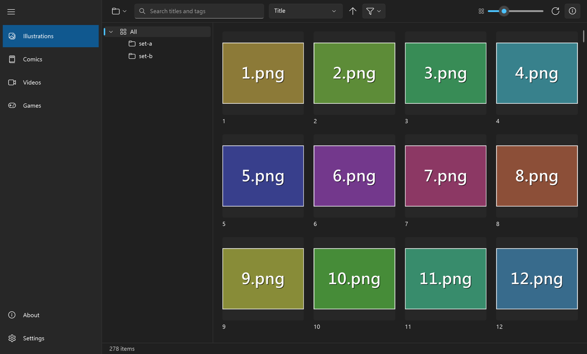
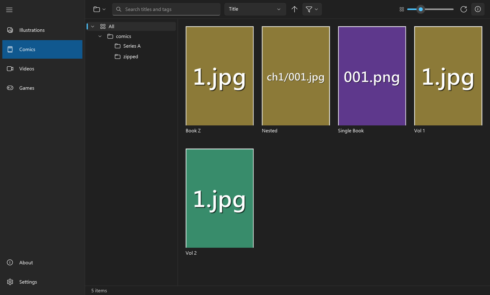
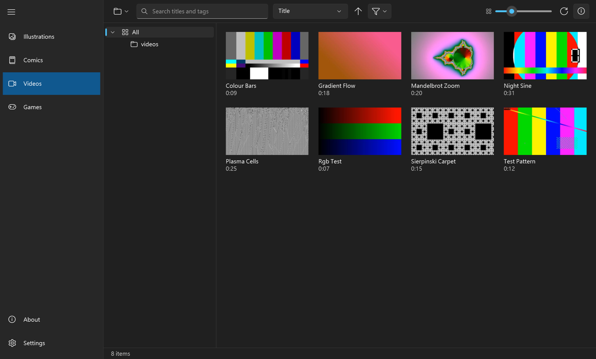
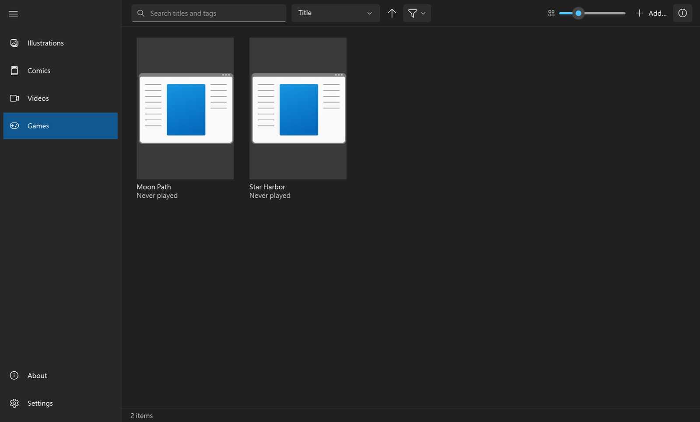
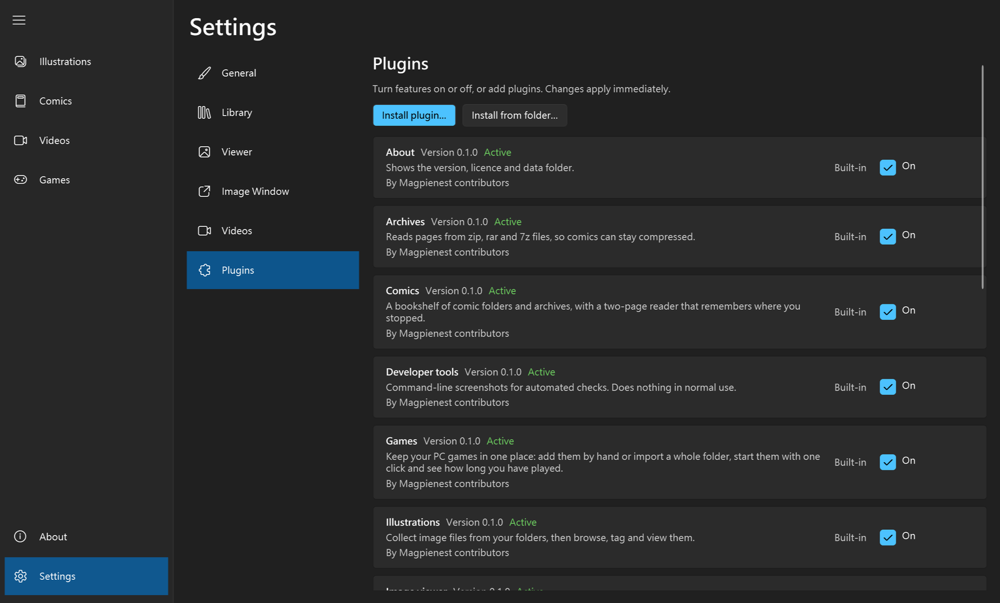

# Magpienest 鵲藏

English | [繁體中文](README.zh-TW.md)

Magpienest is a Windows desktop collection library for your **local** illustrations, comics, videos and games. Every feature is a plugin that you can switch on or off in Settings, with immediate effect. Your files are never moved, renamed or changed: the library is only an index.



## Features

- **Library**: add folders and Magpienest finds everything inside them. Thumbnail walls with a folder tree, search, sorting, filters, tags, ratings, favourites, status and notes. Missing files are marked instead of silently dropped.
- **Illustrations**: JPEG, PNG, GIF, BMP, TIFF, WebP, HEIC, AVIF, JPEG XL and more. A fast full-window viewer with zoom, rotation, preloading of the next pages and a bottom bar. Right-click a picture to open it in a borderless image window of its own.
- **Comics**: a folder of pages or a zip / cbz / rar / cbr / 7z / cb7 archive is one book. Two-page spreads, right-to-left or left-to-right reading, a cover page shown alone, a continuous strip mode, and Magpienest remembers where you stopped.
- **Videos**: plays most formats (mp4, mkv, webm, avi, mov, wmv and many more) with LibVLC. Thumbnails and durations on the wall, resume where you stopped, audio and subtitle track selection, playback speed, one frameless player window per video.
- **Games**: add a game by its exe or let Magpienest scan a folder of game folders and pick the main program of each. Launch with one click; play time and the number of launches are tracked.
- **Plugins**: the main window, Settings, languages and every media page are plugins. Turn them on or off, or install more from a zip or a folder.
- **Languages and themes**: English and Traditional Chinese (switch live, follows Windows by default), light and dark themes.
- **Portable**: unzip and run. All data lives next to the program. Windows 10/11 x64.

|  |  |
|---|---|
|  |  |
|  |  |

The pictures above are generated test data, not real collections.

## Download and run

1. Download `Magpienest-<version>-win-x64.zip` from the **Releases** page of this repository.
2. Unzip it to any folder you can write to (for example `D:\Apps\Magpienest`).
3. Run `Magpienest.exe`. There is nothing to install and no .NET runtime is needed.
4. Add your folders from the toolbar of each page (the folder button, then "Add folder...").

Everything Magpienest stores (library, thumbnail cache, settings, logs, plugins you install) goes to the `data\` folder next to `Magpienest.exe`. To move or back up your library, copy the whole Magpienest folder. To uninstall, delete it. Requirements: Windows 10 or 11, 64-bit.

## Plugins

Open **Settings, Plugins** to see every plugin with its version and state.

- **Turn a plugin on or off** with its switch. It takes effect immediately and is remembered. Essential plugins (such as the main window and Settings) cannot be switched off.
- **Install a plugin** with "Install plugin..." (a `.zip` package) or "Install from folder...". Magpienest shows the name, version and author and asks you to confirm. Plugins run with the same access to your computer as Magpienest itself, so install only plugins you trust.
- **Remove a plugin** with "Remove". Its settings are kept in case you install it again.
- Installing, updating or removing a plugin that is already loaded takes effect after a **restart**; Magpienest shows a bar with a "Restart now" button.

### Safe mode

If a plugin you installed keeps Magpienest from starting, run it in safe mode:

```
Magpienest.exe --safe-mode
```

Only the built-in plugins load. You can then remove or turn off the troublesome plugin in Settings, Plugins and restart normally.

## Build from source

Requirements: Windows 10/11 x64 and the [.NET 10 SDK](https://dotnet.microsoft.com/download).

```
dotnet build Magpienest.slnx -c Debug
dotnet test  Magpienest.slnx -c Debug
artifacts\bin\Debug\Magpienest.exe
```

To make the release zip:

```
build\publish.ps1 -Version 0.1.0
```

It builds and tests in Release, publishes a self-contained win-x64 build, runs a smoke test of the published program and writes `artifacts\Magpienest-0.1.0-win-x64.zip`.

Useful options of the program: `--data-dir <folder>` keeps all data in that folder; `--smoke-test` starts, checks every plugin and exits; `--screenshot <folder>` saves a PNG of every page and exits; `--safe-mode` loads only the built-in plugins.

## Write your own plugin

A tiny kernel loads plugins from `plugins\<id>\` folders, each with a `plugin.json` manifest. Plugins talk to each other only through service interfaces in `Magpienest.Sdk`, and everything a plugin registers is undone automatically when it is switched off. The guide [docs/plugin-development.md](docs/plugin-development.md) takes you from nothing to an installable zip, and [samples/HelloPlugin](samples/HelloPlugin) is a complete example.

## Licence

[MIT](LICENSE).

## Credits

Magpienest builds on .NET and WPF, CommunityToolkit.Mvvm, SQLite, SharpCompress, VirtualizingWrapPanel and LibVLC (LGPL-2.1, dynamically linked). Every component, its licence and where to get its source are listed in [THIRD-PARTY-NOTICES.md](THIRD-PARTY-NOTICES.md).

The design studies two MIT-licensed projects, [NeeView](https://github.com/neelabo/NeeView) (image and book viewing) and [Playnite](https://github.com/JosefNemec/Playnite) (game library management). No code was copied from NeeView; one list of file-name patterns in the game scanner is adapted from Playnite, as recorded in the notices file.
