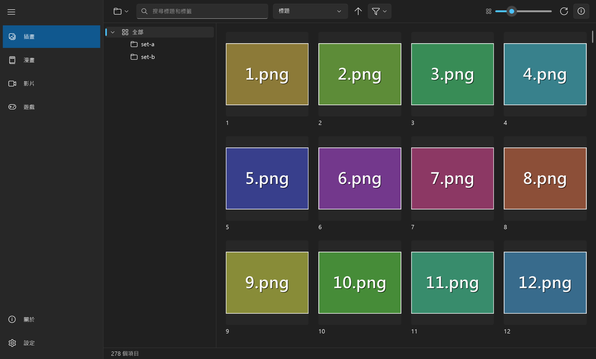
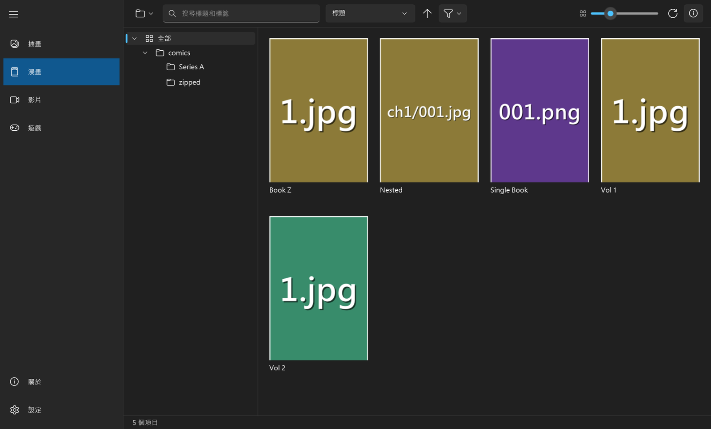
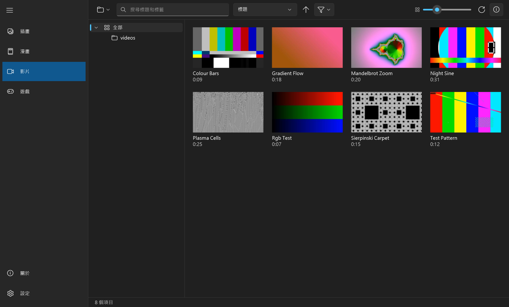
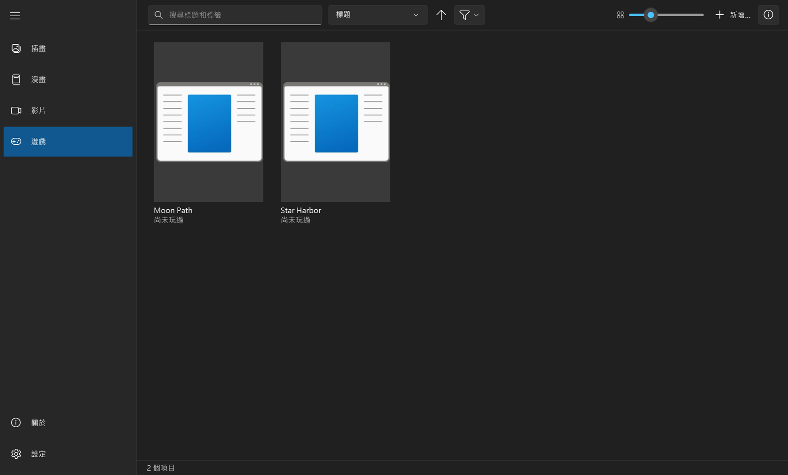
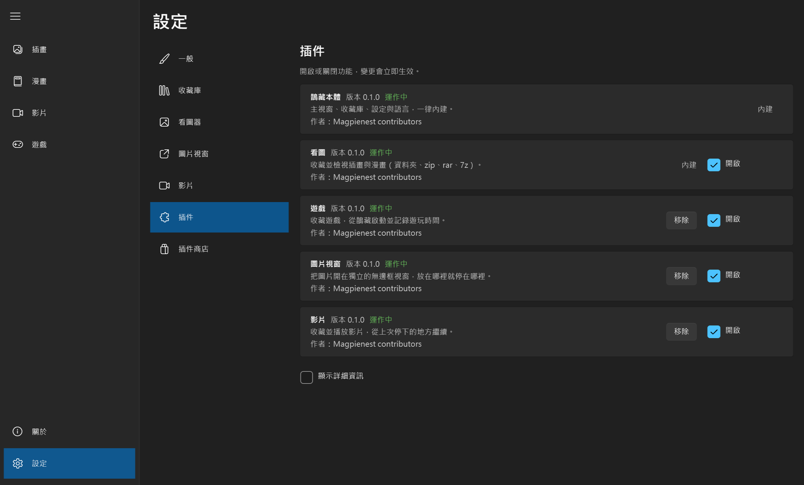

# Magpienest 鵲藏

[English](README.md) | 繁體中文

Magpienest（鵲藏）是 Windows 桌面上的收藏庫，用來整理你電腦裡的**本機**插畫、漫畫、影片與遊戲。所有功能都是插件，可以在「設定」裡隨時開啟或關閉，立即生效。永遠不會移動、改名或修改你的檔案：收藏庫只是一份索引。



## 功能

- **收藏庫**：加入資料夾後，Magpienest 會找出裡面所有內容。縮圖牆搭配資料夾樹，支援搜尋、排序、篩選、標籤、評分、我的最愛、狀態與備註。找不到的檔案會被標示出來，不會悄悄消失。
- **插畫**：支援 JPEG、PNG、GIF、BMP、TIFF、WebP、HEIC、AVIF、JPEG XL 等格式。全視窗的快速檢視器可縮放、旋轉、預先載入後面的圖片，並有底部工具列。在圖片上按右鍵，可以用獨立的無邊框圖片視窗開啟（從插件商店安裝）。
- **漫畫**：一個放著頁面的資料夾，或一個 zip / cbz / rar / cbr / 7z / cb7 壓縮檔，就是一本書。支援雙頁並排、由右至左或由左至右閱讀、封面單獨顯示、連續的長條捲動模式，並且記住你讀到哪裡。
- **影片**（從插件商店安裝）：用 LibVLC 播放大部分格式（mp4、mkv、webm、avi、mov、wmv 等）。縮圖牆顯示縮圖與片長，可接續上次的位置、選擇音軌與字幕、調整播放速度，每部影片各用一個無邊框的播放視窗。
- **遊戲**（從插件商店安裝）：指定 exe 來新增，或讓 Magpienest 掃描整個遊戲資料夾，並為每個資料夾挑出主程式。一鍵啟動，並記錄遊玩時間與啟動次數。
- **插件與插件商店**：每個功能都是插件。下載的程式已包含插畫與漫畫；影片、遊戲、圖片視窗和網頁介面在插件商店裡按一下就能安裝。功能可以開啟或關閉，也能從 zip 或資料夾安裝更多插件。
- **語言與主題**：English 與繁體中文（即時切換，預設跟隨 Windows）、淺色與深色主題。
- **免安裝**：解壓縮就能執行，所有資料都放在程式旁邊。支援 Windows 10/11 x64。

|  |  |
|---|---|
|  |  |
|  |  |

以上圖片都是自動產生的測試資料，不是真實的收藏。

## 下載與執行

1. 從本儲存庫的 **Releases** 頁面下載 `Magpienest-<版本>-win-x64.zip`。
2. 解壓縮到任何你有寫入權限的資料夾（例如 `D:\Apps\Magpienest`）。
3. 執行 `Magpienest.exe`。不需要安裝，也不需要另外安裝 .NET 執行環境。
4. 在每個頁面的工具列加入你的資料夾（資料夾按鈕，然後選「新增資料夾…」）。

Magpienest 儲存的所有東西（收藏庫、縮圖快取、設定、記錄檔、你安裝的插件）都放在 `Magpienest.exe` 旁邊的 `data\` 資料夾。要搬移或備份收藏庫，複製整個 Magpienest 資料夾即可；要移除程式，直接刪除該資料夾。系統需求：Windows 10 或 11，64 位元。

## 插件

打開「**設定」→「插件商店**」可以加裝功能：影片、遊戲、圖片視窗與網頁介面。每張卡片都會顯示大小；按「安裝」會從商店的 GitHub 發布頁下載、檢查後啟用，有新版本時會出現「更新」。開啟「啟動時檢查插件更新」後，有更新時「設定」上會出現小紅點。

打開「**設定」→「插件**」，可以看到你已有的功能。

- **開啟或關閉功能**：使用它的開關。立即生效，並且會被記住。內建的「鵲藏本體」無法關閉。
- **移除功能**：自己安裝的功能可以按「移除」。它的設定會保留，之後重新安裝就能還原。
- **顯示詳細資訊**：列出每個功能包含的插件，並提供「安裝插件…」（`.zip` 套件）與「從資料夾安裝…」，用來安裝從其他地方取得的插件。Magpienest 會顯示名稱、版本與作者，請你確認。插件擁有和 Magpienest 本身相同的電腦存取權限，所以請只安裝你信任的插件。
- 安裝、更新或移除已經載入的插件，要**重新啟動**後才會生效；Magpienest 會顯示一條提示列，上面有「立即重新啟動」按鈕。

### 安全模式

如果你安裝的插件讓 Magpienest 無法啟動，可以用安全模式執行：

```
Magpienest.exe --safe-mode
```

安全模式只載入內建插件。接著你可以在「設定」→「插件」移除或關閉有問題的插件，再正常啟動。

## 從原始碼建置

需求：Windows 10/11 x64 與 [.NET 10 SDK](https://dotnet.microsoft.com/download)。

```
dotnet build Magpienest.slnx -c Debug
dotnet test  Magpienest.slnx -c Debug
artifacts\bin\Debug\Magpienest.exe
```

製作發行用的 zip：

```
build\publish.ps1 -Version 0.1.0 -StoreRepository <owner>/Magpienest-Store
```

它會以 Release 建置並測試，發佈自包含的 win-x64 版本，產生 `artifacts\Magpienest-0.1.0-win-x64.zip`。插件商店的內容放在 `artifacts\store`（每個商店插件一個 zip、`catalog.json` 與商店儲存庫的 README）。發佈出來的程式會做兩次冒煙測試：單獨一次，以及裝好所有商店套件後再一次。

程式的常用參數：`--data-dir <資料夾>` 把所有資料放在指定資料夾；`--smoke-test` 啟動、檢查所有插件後結束；`--screenshot <資料夾>` 為每個頁面存一張 PNG 後結束；`--safe-mode` 只載入內建插件。

## 開發自己的插件

一個很小的核心從 `plugins\<id>\` 資料夾載入插件，每個插件都有一份 `plugin.json` 說明檔。插件之間只透過 `Magpienest.Sdk` 裡的服務介面溝通，插件註冊的所有東西在關閉時都會自動撤銷。[docs/plugin-development.md](docs/plugin-development.md) 會帶你從零開始做出可安裝的 zip，[samples/HelloPlugin](samples/HelloPlugin) 是一個完整的範例。

## 授權

[MIT](LICENSE)。

## 致謝

Magpienest 使用了 .NET 與 WPF、CommunityToolkit.Mvvm、SQLite、SharpCompress、VirtualizingWrapPanel 以及 LibVLC（LGPL-2.1，以動態連結方式使用）。每個元件、它的授權與取得原始碼的方式，都列在 [THIRD-PARTY-NOTICES.md](THIRD-PARTY-NOTICES.md)。

設計參考了兩個 MIT 授權的專案：[NeeView](https://github.com/neelabo/NeeView)（圖片與書本檢視）與 [Playnite](https://github.com/JosefNemec/Playnite)（遊戲庫管理）。沒有複製 NeeView 的程式碼；遊戲掃描器中有一份檔名樣式清單改編自 Playnite，已記錄在授權聲明檔中。
